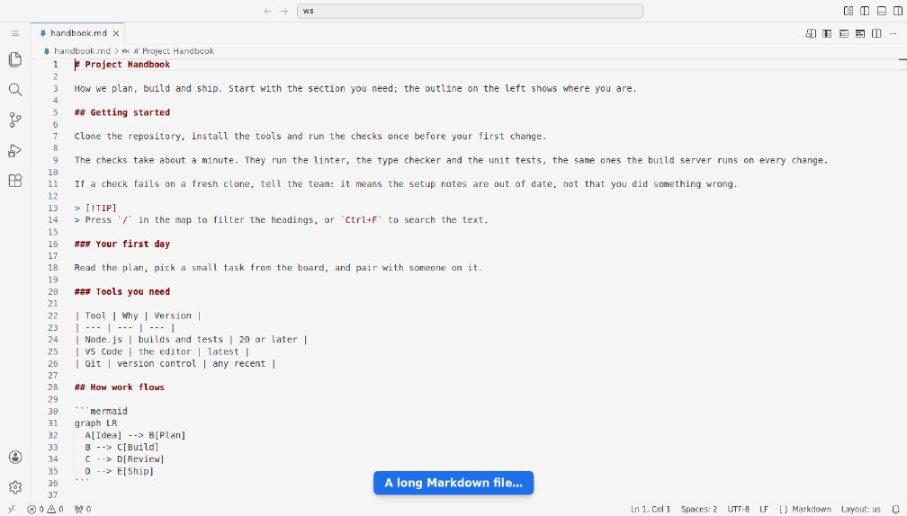

# All-in-One Markdown Viewer

**Click once. Your Markdown becomes a page you can actually read.**

A free extension for VS Code, Cursor, Antigravity, Windsurf and other editors built on VS Code. Latest version:
**2.0.2**.

- **Install for VS Code:** [Visual Studio Marketplace](https://marketplace.visualstudio.com/items?itemName=kish21.markdown-as-web-page)
- **Install for Cursor, Antigravity, Windsurf, VSCodium:** [Open VSX](https://open-vsx.org/extension/kish21/markdown-as-web-page)

## What it does

- **Preview in the same tab** — one click turns a Markdown file into a clean page with a clickable table of contents,
  and back again. No second tab.
- **Docs Inbox** — every Markdown file in your project sorted: changed since you read it, new, worth reading first,
  plans in progress, possible duplicates, probably out of date.
- **Review AI-written plans** — approve, question or request changes section by section, then send your review to
  the AI agent you already use (Copilot, Claude Code, Cursor and others).
- **Read comfortably** — key points at the top, what changed since you last read it, highlights, themes, slides.
- **Write and share** — formatting keys, lists that continue, table and table-of-contents helpers, export to HTML or PDF.

## Privacy

It runs on your computer only. No account, no tracking, no data collected. It runs no AI itself: prompts go to the
agent you choose, and only when you ask.

## Report a problem or suggest an idea

[Open an issue](https://github.com/kish21/docmap-media/issues/new). For a problem, please include:

1. Your editor and its version (VS Code, Cursor, Antigravity, …).
2. The extension version (Extensions view → All-in-One Markdown Viewer).
3. What you did, what you expected, and what happened — a screenshot helps a lot.

---

This repository holds the extension page's pictures and the public issue tracker. The extension's source code is kept
private.
